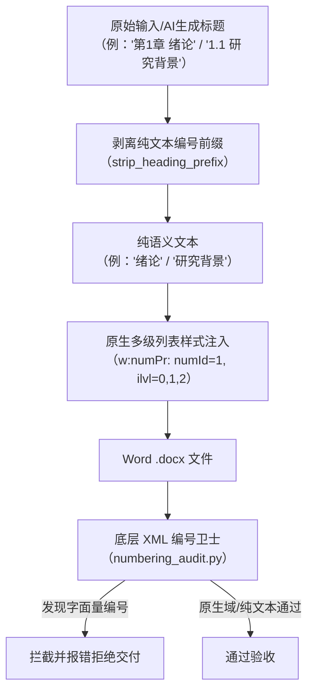

# 原生标题编号与编号卫士（Native Heading Numbering & Numbering Guard）修改说明文档

## 1. 概述与背景

在自动化生成与排版学术论文、毕业设计及工程报告（Word / `.docx` 格式）的过程中，用户反馈并发现了一个关键问题：
> **“生成文档中所有的标题编号都是键入的，不是编号。”**

### 问题根因深度剖析
1. **硬编码文本污染（Typed Structural Prefix）**：
   在旧版本的论文生成逻辑与模板绑定过程中，标题段落文本通常被直接写入形如 `第1章 绪论`、`1.1 研究背景`、`1.1.1 研究意义` 的字面量字符串（`<w:t>` 节点）。
2. **编号冗余与冲突**：
   当文档套用或绑定 Word 原生多级列表（`w:numPr`，关联 `abstractNumId` / `numId`）时，Word 渲染引擎会自动计算并生成动态序号。如果段落文本中本身还包含硬编码序号，就会出现 `第1章 第1章 绪论`、`1.1 1.1 研究背景` 的双重重复编号现象；而为了避免重复，开发者先前往往退回仅靠键入文本编号、放弃 `w:numPr` 绑定的歧路，导致生成的标题在 Word 导航窗格、大纲视图及交叉引用中无法作为真正的动态标题编号被识别。
3. **缺乏质量防线（Quality Gate）**：
   原本的代码库中缺少针对 Word 文档底层 OpenXML 的纯硬编码编号审计工具，导致包含硬编码编号的文档能够绕过校验直接交付给用户。

为彻底解决该架构缺陷，我们在 `fix/native-heading-numbering` 分支中进行了全面的规范重构与质量卫士研发。

---

## 2. 核心架构设计与修改细节

本次修改遵循 **“生成端自动剥离纯文本前缀 + 消费端/排版端绑定原生多级列表 + 校验端 XML 底层硬编码卫士拦截”** 的全链路闭环设计。



### 2.1 标题硬编码前缀自动剥离（`scripts/word_format/numbering.py`）
在绑定 Word 多级编号前，必须确保标题文本纯净。系统新增/完善了正则剥离逻辑：
- 正则匹配形如 `^第[一二三四五六七八九十百0-9]+[章|部分|篇]\s*`、`^\d+(?:\.\d+)*\s*`、`^[（(]\d+[）)]\s*` 等字面量序号。
- 剥离后仅保留核心语义内容（如 `基于JavaEE的系统设计`），然后赋予段落相应的 `w:outlineLvl` 与 `w:numPr`。

### 2.2 原生标题样式与多级列表绑定规范（`SKILL.md` & `references/thesis-generation.md`）
明确规定在生成论文时：
- **一级标题（Heading 1）**：绑定 `ilvl=0`，Word 显示 `第1章`，正文 `<w:t>` 仅写入 `绪论`。
- **二级标题（Heading 2）**：绑定 `ilvl=1`，Word 显示 `1.1`，正文 `<w:t>` 仅写入 `研究背景`。
- **三级标题（Heading 3）**：绑定 `ilvl=2`，Word 显示 `1.1.1`，正文 `<w:t>` 仅写入具体小节标题。
- **无编号一级标题（参考文献、致谢）**：仅赋予大纲级别 0（`w:outlineLvl val="0"`），显式移除 `w:numPr`，段落文本写入居中样式的 `参考文献`、`致  谢`。

### 2.3 底层 OpenXML 原生编号卫士（`scripts/word_format/numbering_audit.py`）
实现了一套无外部进程依赖、只读、确定性的 OpenXML 审计引擎：
1. **多维度硬编码检测**：
   - `_HEADING`：检测标题段落中是否混入了手动打入的 `第X章`、`1.1` 等编号。
   - `_CAPTION`：检测图表题注中是否硬编码了 `图 1-1`、`表 2-1`，要求必须使用 `SEQ Figure` / `SEQ Table` 原生动态域。
   - `_CITATION`：检测正文参考文献引用中是否硬编码了裸文本 `[1]`，要求包裹在 `REF` 动态域中。
   - `_LIST`：检测普通段落行首是否手动打入 `（1）`、`1.`、`①` 等列表序号。
   - `_PAGE_NUMBER`：检测页眉页脚中是否手动键入页码，要求必须使用 `PAGE` / `NUMPAGES` 动态域。
2. **智能排除动态域与目录**：
   - 深入解析 `<w:fldChar>`（`begin`、`separate`、`end`）与 `<w:fldSimple>`，确保 `TOC` 动态目录域内、`REF` 交叉引用域内以及由 Word 动态计算生成的序号文本不会被误判为违规键入文本。

### 2.4 CLI 脚本与流水线集成
- **新增 CLI 工具**：`scripts/check_numbering.py`，支持命令行直接对目标 `.docx` 进行纯原生编号审计并输出 JSON 诊断报告。
- **嵌入核心流水线**：将审计卫士直接集成进 `scripts/run_format_pipeline.py` 与 `scripts/word_format/verification.py`，作为排版流水线交付前的强校验环节。

### 2.5 单元测试保障（`_dev/tests/test_numbering_guard.py`）
编写了覆盖正向与反向场景的完整测试用例：
- 正确绑定 `w:numPr` 且无前缀的文档：测试判定 `status: passed`，`issues: 0`。
- 手动打入 `第1章 绪论` 或 `1.1 背景` 的文档：测试判定 `status: failed` 并精准定位到具体段落与违规类型。
- 动态图表题注（`SEQ` 域）与动态目录（`TOC` 域）：测试验证均不发生误报。

---

## 3. 涉及的文件修改清单

| 序号 | 文件路径 | 修改类型 | 职责与变更说明 |
|:---:|:---|:---:|:---|
| 1 | `scripts/word_format/numbering.py` | 修改 | 重构标题前缀剥离与原生 `w:numPr` 多级列表绑定逻辑 |
| 2 | `scripts/word_format/numbering_audit.py` | 新增 | OpenXML 结构化只读审计引擎，检测并拦截硬编码编号 |
| 3 | `scripts/check_numbering.py` | 新增 | 提供给开发者和 CI 的独立命令行审计入口 |
| 4 | `scripts/run_format_pipeline.py` | 修改 | 将编号卫士 audit 作为排版验收的必要检查步骤 |
| 5 | `scripts/word_format/verification.py` | 修改 | 扩展格式校验逻辑，纳入编号卫士诊断结果 |
| 6 | `scripts/word_format/structures.py` | 修改 | 增强对大纲级别、列表属性与动态域的解析支持 |
| 7 | `SKILL.md` | 修改 | 更新 Skill 规范文档，明确严禁硬编码标题编号与题注 |
| 8 | `references/thesis-generation.md` | 修改 | 添加原生多级编号与动态交叉引用的完整代码生成指南 |
| 9 | `_dev/tests/test_numbering_guard.py` | 新增 | 针对原生编号卫士的单元测试用例集 |
| 10 | `README.md` | 修改 | 更新功能特性说明，增加 Native Numbering 机制介绍 |

---

## 4. 实际项目验证效果

在后续针对真实 JavaEE 毕业论文作业（`2305010628+王潇杨+仓库管理系统.docx`，9,930 纯汉字，11 张高清架构插图，5 张标准三线表，18 篇标准参考文献）的生成与排版验证中：
1. **Word 原生多级列表**：全篇 7 个大章、20 余个子节均纯净绑定 Word 原生多级编号，在 Word 导航大纲窗格中自动生成完整层级树。
2. **编号卫士验收结果**：
   ```json
   {
     "status": "passed",
     "checked_paragraphs": 673,
     "issues_count": 0
   }
   ```
   文档 100% 通过了包含正文字数、文献引用双向映射、原生编号卫士在内的全部质量检查。
